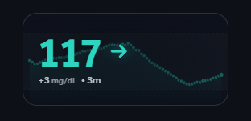
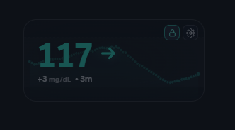

# AlGlucoMon

A sleek, lightweight, always-on-top Windows desktop glucose overlay for **Dexcom G7**, built with **Tauri v2**, **React**, **TypeScript**, and **Rust** by **Almoukhtar Amiouni**.

## Screenshots (Windows Desktop)

*The screenshots below show the Windows desktop overlay:*

| Live Overlay | Hovering a Reading Dot | Click-Through Locked (Dimmed) |
| :---: | :---: | :---: |
|  |  |  |

## Features

- **Minimal Glassmorphic Overlay:** Crisp `tabular-nums` glucose reading, animated trend arrow, delta, reading age, and stale-data strikethrough after 10 minutes.
- **Background Trend Graph:** Toggleable full-bleed glucose trend behind the readout (`1h` / `3h` / `6h`) with **Smooth curve** or **Dots** mode.
  - In **Dots** mode, each dot is colored by your target range and hovering over any dot displays that reading's value and exact timestamp.
- **Smart Click-Through Lock:** Dims the overlay to your chosen opacity and lets mouse clicks pass straight through to apps or games underneath. Hold `Alt` (or `Ctrl` / `Shift`) at any time to temporarily interact, hover dots, drag the overlay, or click the lock icon to unlock.
- **Customizable Themes & Sizes:** Dark Glass, Adaptive Range Glow, Light Glass, and OLED Black themes; Compact, Standard, and Large sizes; `mg/dL` or `mmol/L`.
- **First-Launch Sign-In & System Tray:** Prompts for your Dexcom Share credentials on first launch and stays accessible from the Windows system tray.

## Dexcom G7 Prerequisites

AlGlucoMon reads live readings from **Dexcom Share**:

1. Enable **Dexcom Share** inside your official Dexcom G7 mobile app (`Connections -> Share`).
2. Add and accept at least **one follower** (Dexcom's servers only publish Share readings when at least one active follower exists).
3. Sign in inside AlGlucoMon using the **wearer's primary Dexcom account** (not a follower account) and select the matching region (`US`, `Outside US`, or `Japan`).

## Installation (Windows)

- **Installer:** Download `AlGlucoMon_0.1.2_x64-setup.exe` from the [Releases](../../releases) page and run it.
- **Portable (no install):** Download `AlGlucoMon_0.1.2_x64-portable.zip`, extract anywhere (e.g., a folder or USB drive), and run `AlGlucoMon.exe`. The included `portable.txt` marker keeps `settings.json` and WebView2 data inside the same folder with zero AppData or Windows Registry entries (and disables **Launch on Windows startup**).

## Installation (Android 8.0+)

- Download `AlGlucoMon_0.2.0_android.apk` from the [Releases](../../releases) page and sideload it on any **Android 8.0 (Oreo) – Android 15** phone or tablet (including older tablets like the LG G Pad 5 10.1).
- Includes both a **Fullscreen Brightness-Reactive Sugar Display** (100% pure `#000000` OLED black background for battery savings, always-on screen, ambient light auto-dimming, night low-glare mode, burn-in pixel shift) and the **Floating System Overlay**.

### Android Controls

**Fullscreen Sugar Display:**
- **Tap anywhere** on the screen to show or hide the bottom control bar (**Switch to Overlay**, **Brightness: Auto / Manual**, **Refresh**, and **Settings**).
- **Drag across the graph** (in **Dots** mode) to scrub past readings and inspect any dot's glucose value and exact timestamp.
- **Auto brightness** reacts to your device's ambient light sensor (bright in daylight, ultra-dim in dark rooms) with a **100% true black OLED background** to reduce battery consumption.

**Floating System Overlay:**
- **Drag** anywhere on the overlay card to move it (remembers separate **Portrait** and **Landscape** positions).
- **Tap** the overlay card (in **Dots** mode) to enter **Inspect Mode** — drag your finger across dots to read individual values/timestamps, tap **Open** to launch Fullscreen Display/Settings, or tap **Done** to return to normal drag mode.
- **Persistent Notification & Status Bar:** Shows your live glucose number directly in the status bar with 1-tap **Lock / Unlock** (toggles click-through + dimmed opacity), **Display**, and **Hide** actions.
- **Quick Settings Tile:** Pull down Quick Settings and add the **AlGlucoMon Overlay** tile to toggle the floating overlay on/off from any app.

## Building from Source

Requires **Node.js (v18+)**, **Rust**, and Windows **WebView2** (pre-installed on Windows 10/11).

```powershell
npm install
npm run tauri dev     # run in development
npm run tauri build   # build Windows installer
```

## Medical Disclaimer

AlGlucoMon is an unofficial open-source companion display and is **not** a medical device. Never rely solely on this overlay for insulin dosing or clinical treatment decisions — always verify readings on your official Dexcom G7 app or receiver.

## License

Copyright (C) 2026 **Almoukhtar Amiouni**.  
Licensed under the **GNU General Public License v3.0 (GPL-3.0)** — see [LICENSE](LICENSE) for full terms.
