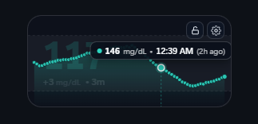

# AlGlucoMon

A sleek, lightweight, always-on-top Windows desktop glucose overlay for **Dexcom G7**, built with **Tauri v2**, **React**, **TypeScript**, and **Rust** by **Almoukhtar Amiouni**.

## Screenshots

| Live Overlay | Hovering a Reading Dot | Click-Through Locked (Dimmed) |
| :---: | :---: | :---: |
|  |  |  |

## Features

- **Minimal Glassmorphic Overlay:** Crisp `tabular-nums` glucose reading, animated trend arrow, delta, reading age, and stale-data strikethrough after 10 minutes.
- **Background Trend Graph:** Toggleable full-bleed glucose trend behind the readout (`1h` / `3h` / `6h`) with **Smooth curve** or **Dots** mode.
  - In **Dots** mode, each dot is colored by your target range and hovering over any dot displays that reading's value and exact timestamp.
- **Smart Click-Through Lock:** Dims the overlay to your chosen opacity and lets mouse clicks pass straight through to apps or games underneath. Hold `Alt` (or `Ctrl` / `Shift`) at any time to temporarily interact, hover dots, drag the overlay, or click the lock icon to unlock.
- **Customizable Themes & Sizes:** Dark Glass, Adaptive Range Glow, Light Glass, and OLED Black themes; Compact, Standard, and Large sizes; `mg/dL` or `mmol/L`.
- **First-Launch Sign-In & System Tray:** Prompts for your Dexcom Share credentials on first launch and stays accessible from the Windows system tray.

## Dexcom G7 Prerequisites

AlGlucoMon reads live readings from **Dexcom Share**:

1. Enable **Dexcom Share** inside your official Dexcom G7 mobile app (`Connections -> Share`).
2. Add and accept at least **one follower** (Dexcom's servers only publish Share readings when at least one active follower exists).
3. Sign in inside AlGlucoMon using the **wearer's primary Dexcom account** (not a follower account) and select the matching region (`US`, `Outside US`, or `Japan`).

## Installation (Windows)

Download `AlGlucoMon_0.1.0_x64-setup.exe` from the [Releases](../../releases) page and run the installer.

## Building from Source

Requires **Node.js (v18+)**, **Rust**, and Windows **WebView2** (pre-installed on Windows 10/11).

```powershell
npm install
npm run tauri dev     # run in development
npm run tauri build   # build Windows installer
```

## Medical Disclaimer

AlGlucoMon is an unofficial open-source companion display and is **not** a medical device. Never rely solely on this overlay for insulin dosing or clinical treatment decisions — always verify readings on your official Dexcom G7 app or receiver.

## License

Copyright (C) 2026 **Almoukhtar Amiouni**.  
Licensed under the **GNU General Public License v3.0 (GPL-3.0)** — see [LICENSE](LICENSE) for full terms.
